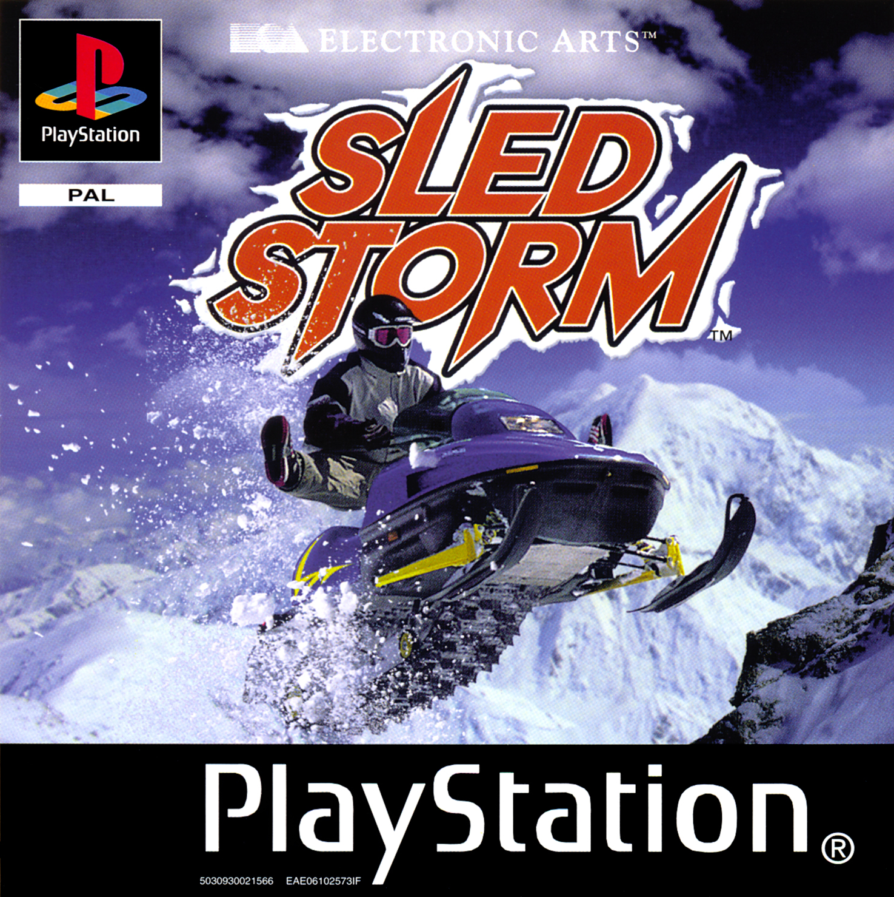

# Sled Storm Browser

**Version 0.8.1 · experimental · [Changelog](CHANGELOG.md)**

Play **Sled Storm (1999), PlayStation PAL SLES-02194**, in your browser with up
to **four players in one room**. Each browser runs PCSX-ReARMed and controls one
sled, with its own full camera and the original single-player HUD. Game modes,
riders, sleds and courses are selected in the original game menus.

<p align="center">
  
</p>

*Cover scan: [PSX Data Center](https://psxdatacenter.com/images/hires/P/S/SLES-02194/SLES-02194-F-ALL.html).
Original game artwork is not covered by the wrapper's MIT license.*

## ▶ Start, invite, stop

> [!IMPORTANT]
> **Only the host installs and runs this project.** Friends open an invitation
> in their browsers. One CUE/BIN set on the host is enough. Guests can download
> the shared archive for the session or reuse a ZIP they saved earlier.

### 1. Set up once

On macOS or Linux, install **Python 3.10+, Git, Bash, make, Node.js 22+ with
npm**, and **bsdtar/libarchive** (`tar` on macOS). Internet play also requires
[cloudflared](https://github.com/cloudflare/cloudflared#installing-cloudflared).
Install Chrome on the host for dedicated rooms. Use a desktop browser with
WebAssembly and WebGL2 to play. macOS has been tested;
Linux setup has not been qualified.

Clone the project and build it from the terminal:

```sh
git clone https://github.com/watscho/sledstorm-browser.git
cd sledstorm-browser
python3 tools/bootstrap-emulator.py
python3 tools/build-emulator.py
mkdir -p game
```

Copy your **PAL SLES-02194 CUE file and all eleven BIN tracks** into `game/`.
Keep their filenames unchanged. The scripts download emulator dependencies,
not the game. The first build can take time and needs several GB of free space.
You only need to repeat the build after updating emulator or native adapter code.

### 2. Start the game

Open a terminal in the project folder and run:

```sh
python3 tools/play-online.py
```

Wait until the terminal prints **Host launcher**, then:

1. Open **[http://127.0.0.1:8000/](http://127.0.0.1:8000/)** on the host computer.
2. Choose your settings and click **Start game**. While playing alone, use
   **Load last save** in the game toolbar to restore a saved game.
3. Click **Copy invite link** in the session toolbar and send the complete link
   to your friends. It automatically uses the public HTTPS address.
4. Each friend opens the link and clicks **Join game**. In the game data dialog,
   choose an existing ZIP, save a new ZIP and join, or join without saving.
   Wait for synchronization.

The four indicators below the game light up as controllers connect. If you
lose your connection during a race, reopen the room from the same browser
and address to resume your controller.

Keep the terminal open and the host computer awake. With a Quick Tunnel in
Chrome, **Join game** lets you open an existing ZIP or choose where to save one
when **Keep or choose game data** is checked. Select the same ZIP on a new tunnel
address to reuse the full disc, including music. You can also join without
saving. A permanent HTTPS address reuses its browser copy
automatically. Each new game started from the launcher gets its own room.
See [disc downloads and browser storage](docs/multiplayer.md#disc-downloads-and-browser-storage).

### 3. Enter a race together

In the original game, choose **Start → Multiplayer quick race**. Each player
presses **S** to join with the default keyboard layout, then chooses and confirms
a rider. Player 1 chooses the course and starts the race. Up to **four players total** can join a room.

| Key | Action |
| --- | --- |
| Arrow keys | Navigate / steer |
| **S** | Confirm / accelerate (Cross) |
| **Enter** | Start / pause |
| **W** | Triangle / back |
| **A** / **D** | Square / Circle |
| **Q** / **E** | L1 / R1 |
| **Z** / **C** | L2 / R2 |
| **Right Shift** | Select |

Open **Controls** before launching to choose Classic or WASD, click a button on
the DualShock illustration to rebind it, or remap a connected gamepad. Your
chosen layout, Custom bindings and controller mappings are saved in your
browser. See [personal controls](docs/browser-lobby.md#personal-controls).

Click the game if the keyboard does not respond. Register each rider before
starting the race. A returning guest can open the same invitation and resume
from the current race state once their game files load.

### 4. Switch everything off

> [!TIP]
> In the terminal running the game, press **Ctrl+C** once.
> Wait for **Online stack stopped.** This stops the game server, relay, gateway
> and Cloudflare Tunnel started by the helper. Then close the game tabs.
>
> In browser-hosted mode, closing the host's tab ends the room. The hosting terminal can still serve
> the launcher. To play again after stopping the tunnel, restart the helper
> and send the new invitation.

## Other ways to play

| What you want | Command |
| --- | --- |
| Dedicated internet room with persistent controller slots | `python3 tools/play-online.py` |
| Internet play hosted by the creator's browser | `python3 tools/play-online.py --browser-hosted` |
| Internet play; each player selects matching CUE/BIN files | `python3 tools/play-online.py --disc-mode local` |
| Play locally in a dedicated room, without a tunnel | `python3 server.py` |
| Play locally with the room hosted in the creator's browser | `python3 server.py --browser-hosted` |

Run only one hosting command at a time. Stop it with **Ctrl+C** before changing
modes. Use the localhost address for local-only play. To invite another
computer, including one on the same Wi-Fi, use the online launcher and copy
its HTTPS invitation.

## Settings and session behavior

Choose race aspect ratio, image filtering, volume and **Enhanced 2×** in
**Display and audio**. Solo PAL races and dedicated personal cameras default to
**16:9** with **Clean · Sharp Bilinear** filtering. **4:3 · Original** is
available for races, and menus and shared split-screen stay in 4:3.
The in-game toolbar also offers filter switching, PNG screenshots and
fullscreen (**Alt+Enter**).

The game autosaves in the browser while the room creator plays alone. Use
**Save game** for a manual snapshot or **Load last save** to open a fresh room
from it. Saves pause while a guest is connected or has a reserved race seat.
See [solo sessions and shortcuts](docs/browser-lobby.md#solo-sessions).

**All content unlocked** is enabled by default and applies to temporary game
memory. Disc files and persistent memory cards are unchanged. Optional BIOS
files must match across all players; leaving BIOS empty uses HLE.

Guests inherit the room's progression and camera settings. Volume and image
filtering are personal. Native pause menus remain shared and retain their 4:3
proportions. Each browser emulates the console locally; networking exchanges
controller inputs and emulator state through RetroArch Netplay.

## Current limits

- **Game files.** Use the PlayStation PAL SLES-02194 CUE and all eleven BIN
  tracks. Standalone ISO/CHD, other regions and the PS2 game are outside the
  supported setup. [Disc setup](docs/setup.md#add-the-game-files)
- **Room behavior.** RetroArch sends the current emulator state to guests
  once they load the disc. Register each rider in the game's multiplayer menu
  before starting the race. A returning controller can resume its existing
  racer. In a dedicated room, the server keeps the race moving while browsers
  catch up or reconnect. A room stays available while the hosting process runs
  and players remain connected.
  [Rooms and synchronization](docs/multiplayer.md#rooms-and-synchronization)
- **Presentation.** Dedicated personal cameras and solo PAL races support
  widened race geometry and native 2× rendering. Browser-hosted multiplayer,
  shared split-screen and menus use the original frame for upscaling. The HUD
  keeps native rasterization in Enhanced 2×.
  [Camera details](docs/browser-emulator.md#cameras-progression-and-technical-settings)
- **Test coverage.** v0.8.0 checks include a solo PAL race in Chrome with
  Enhanced 2× in both 4:3 and 16:9. The four-player Cloudflare gameplay check
  used four browser contexts on one Mac in v0.6.0. Separate computers,
  physical gamepads and soundtrack quality still need hands-on testing.
  [Verification record](docs/verification.md)

## Documentation

[Browse all documentation](docs/README.md).

- [Installation and troubleshooting](docs/setup.md)
- [Playing with friends and hosting](docs/multiplayer.md)
- [Launcher settings](docs/browser-lobby.md)
- [All-content preset](docs/unlocked-profile.md)
- [Emulator architecture and source pins](docs/browser-emulator.md)
- [Verification and known limits](docs/verification.md)
- [Contributing and checks](CONTRIBUTING.md)

## Sources and license

Built with [EmulatorJS](https://github.com/EmulatorJS/EmulatorJS),
[PCSX-ReARMed](https://github.com/EmulatorJS/pcsx_rearmed) and
[RetroArch](https://github.com/EmulatorJS/RetroArch). Exact versions and source
commits are documented in [third-party notices](THIRD_PARTY_NOTICES.md).

OpenEmu inspired the in-game shortcuts, solo save workflow and controller
remapping. See the [design credit and implementation sources](THIRD_PARTY_NOTICES.md#interface-inspiration).

Original wrapper, networking and tooling contributions are **MIT**, copyright
**Vacho Aivazov**. Upstream components retain their own licenses. Game images,
BIOS, compiled emulator binaries, memory cards and private invitations are
excluded from Git. Game content and trademarks belong to their respective
owners. This project is not affiliated with Electronic Arts or upstream authors.
